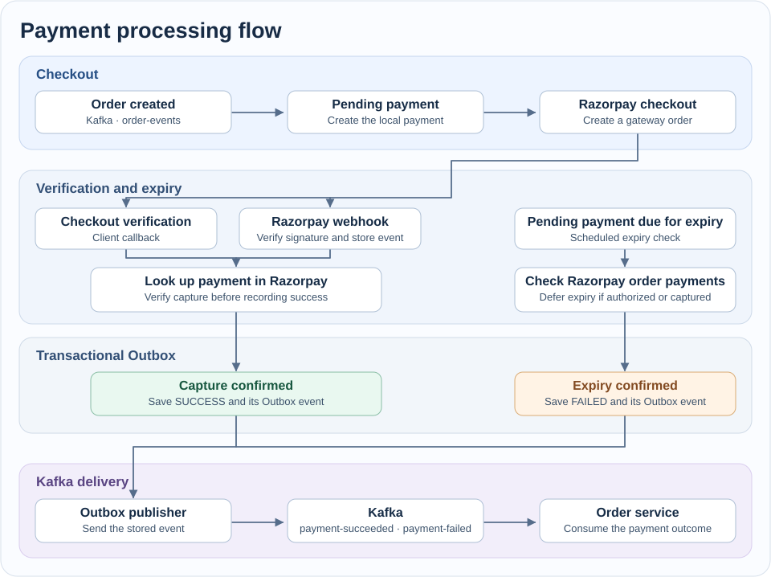

<h1 align="center">Payment Service</h1>

  <strong>Razorpay checkout and payment reconciliation for an event-driven e-commerce platform</strong>

  
  
  
  
  

---

The Payment Service owns the payment lifecycle for e-commerce orders. It creates Razorpay checkout orders, verifies callbacks and webhooks, and publishes payment outcomes to the order service through Kafka. Payment state changes and their outgoing events are recorded together in MySQL using a transactional outbox.

The service handles cases where Razorpay confirms a capture after a payment has expired locally. It verifies the capture with Razorpay, reconciles the payment and its attempt to `SUCCESS`, and records a single success outbox entry even when the webhook is replayed.

## Payment Events

The Payment Service consumes order creation events from Kafka and publishes payment outcomes back to the order service. Razorpay webhooks arrive over HTTP. The service verifies them before updating payment state and recording the corresponding Outbox event.

| Direction | Kafka topic | Event | When it’s used |
|---|---|---|---|
| Consumes | `order-events` | `OrderCreatedKafkaEvent` | Creates a `PENDING` payment for a new order. A replay reuses the payment already associated with that order. |
| Publishes | `payment-succeeded` | `PaymentSucceededEvent` | Razorpay confirms a capture through webhook reconciliation or checkout verification. The event includes `eventId`, `paymentId`, `orderId`, and `amount`. |
| Publishes | `payment-failed` | `PaymentFailedEvent` | A pending payment expires locally after a check with Razorpay. The event includes `eventId`, `paymentId`, `orderId`, and `reason`. |

A Razorpay `payment.failed` webhook can mark an individual **attempt** as failed. The local expiry flow marks the **payment** as failed and queues the Kafka event the order service uses to cancel a pending order.

Both outgoing topics use the **order ID as the Kafka message key**. The Outbox publisher reuses the stored event ID when it retries a send, so the order service can recognize a replay. Since success and failure travel on separate topics, they can arrive in either order.

[Order consumer](src/main/java/com/aashir/payment/kafka/OrderKafkaConsumer.java) · [Outbox service](src/main/java/com/aashir/payment/service/OutboxService.java) · [Expiry service](src/main/java/com/aashir/payment/service/PaymentExpiryService.java)

## How It Works

The payment starts when the order service publishes an order creation event. Checkout verification and Razorpay webhooks give the Payment Service two ways to discover a capture. Both paths verify the payment with Razorpay before recording success.

1. **Start checkout.** The client calls `POST /payments/{orderId}/checkout` with an `Idempotency-Key`. The service checks that the payment belongs to the signed-in customer, then saves the checkout request and payment attempt before calling Razorpay with the amount and currency from the stored payment. When Razorpay returns an order ID, the service attaches it to the attempt and returns the checkout details. If the client retries a completed request with the same key, it gets the original checkout details. A gateway timeout leaves the attempt open because Razorpay may have created the order before the response was lost.

2. **Verify the result.** The client can submit the checkout result to `POST /payments/verify` as soon as checkout finishes. Razorpay can also call `POST /api/webhooks/razorpay`, which lets the service reconcile a capture even if the customer closes the browser before the callback reaches the server. The webhook endpoint verifies the signature on the original request body, stores the event, and acknowledges it. A scheduled worker handles the gateway lookup. Both paths use the payment and order references, amount, and currency to match the Razorpay response to the right local payment.

3. **Save the outcome and publish it.** When Razorpay confirms a capture, the service updates the payment and attempt to `SUCCESS` and records the success event in the same MySQL transaction. The expiry path also checks Razorpay before closing a pending payment. If expiry goes ahead, the failure and its event are saved together. The Outbox publisher sends stored events to Kafka and marks each row published after Kafka acknowledges the send. If Kafka is unavailable, the row stays pending and the publisher can try again on a later run.

[Checkout service](src/main/java/com/aashir/payment/service/CheckoutService.java) · [Webhook processor](src/main/java/com/aashir/payment/service/WebhookEventProcessor.java) · [Outbox publisher](src/main/java/com/aashir/payment/service/OutboxPublisher.java)

## Reliability

A payment can be reported by the browser callback, a Razorpay webhook, or both. The service uses the current Razorpay status to decide what happened and MySQL to track what it has already processed.

| Situation | What the service does |
|---|---|
| Razorpay retries the same webhook delivery | Acknowledges the duplicate and keeps the original `webhook_events` row, using `x-razorpay-event-id` to identify it. |
| A new webhook reports a capture already recorded | Preserves the successful payment and attempt. A unique Outbox key keeps one success record per payment. |
| A write fails during capture reconciliation | Rolls back the payment, attempt, and success Outbox entry together. The webhook can be retried. |
| Kafka accepts an event before the publisher records completion | The publisher may send it again with the same `eventId`, which the order service uses to recognize a replay. |

### Webhook retries and recovery

The webhook endpoint stores a signed event before acknowledging it. A scheduled worker scans for eligible events every **5 seconds** by default. After a failed attempt, the next retry becomes eligible after **5 seconds, 15 seconds, 45 seconds, 2 minutes, or 5 minutes**, depending on the attempt number. If the sixth attempt fails, the event is marked `DEAD` and its last error remains available for investigation.

The worker also recovers events that have been stuck in `PROCESSING` for more than **10 minutes**. This covers a restart or crash after an event was claimed. The recovered event follows the same retry rules.

### Expiry and late capture

A pending payment becomes eligible for local expiry after **30 minutes**. Before expiring it, the service checks Razorpay for each linked checkout order. If Razorpay reports an `authorized` or `captured` payment, or the lookup fails, the service defers expiry.

Razorpay can still confirm a capture after that check. When it does, the Payment Service reconciles the payment and attempt to `SUCCESS`. If the order service has already cancelled the order and released its stock, it preserves `CANCELLED` and saves one `late_payment_reviews` record for the order and payment. That record gives an operator a way to follow up on the captured funds.

[Webhook retry rules](src/main/java/com/aashir/payment/entity/WebhookEvent.java) · [Expiry service](src/main/java/com/aashir/payment/service/PaymentExpiryService.java) · [Order consumer](https://github.com/Aashirshaikh07/e-commerce-spring-boot/blob/main/src/main/java/com/aashir/ecommerce/kafka/PaymentKafkaConsumer.java)
